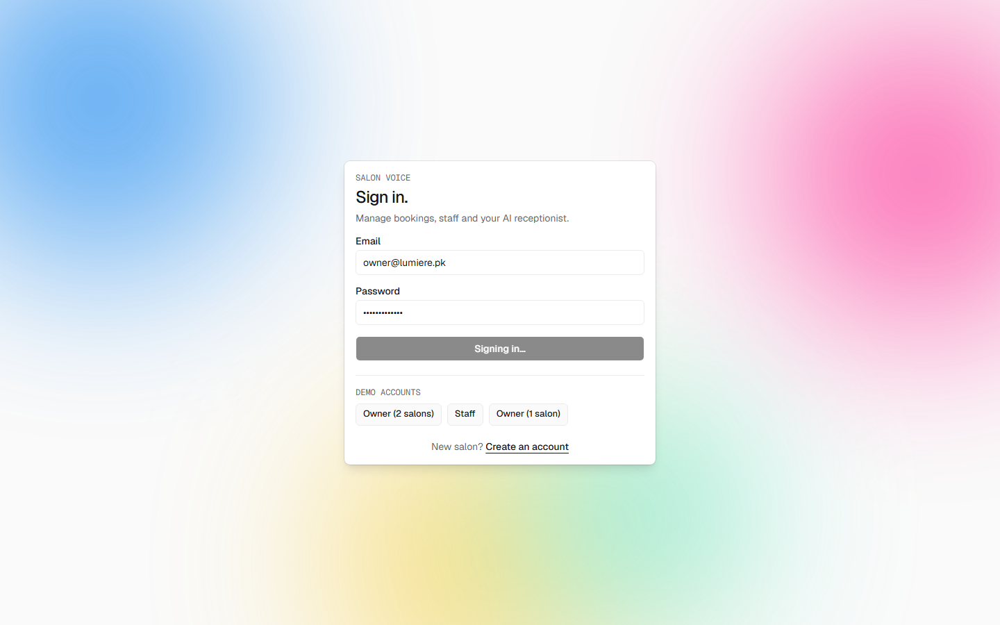
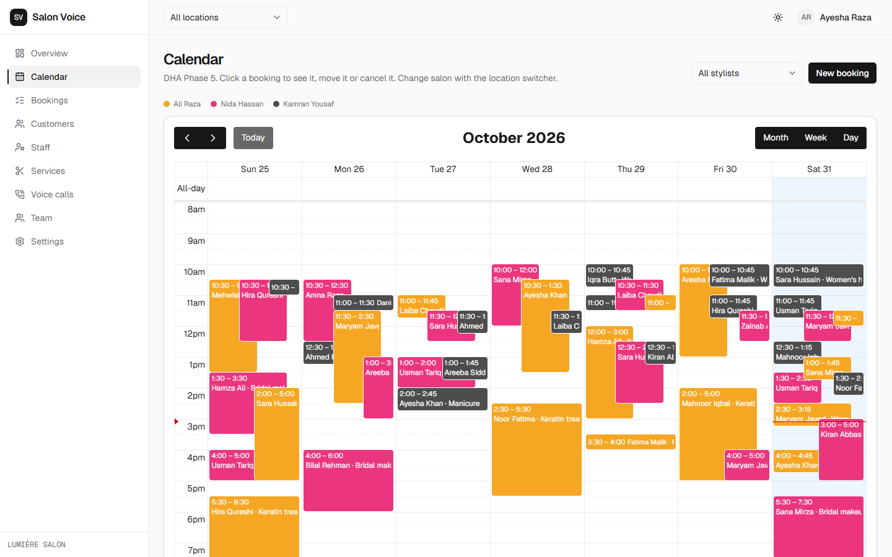
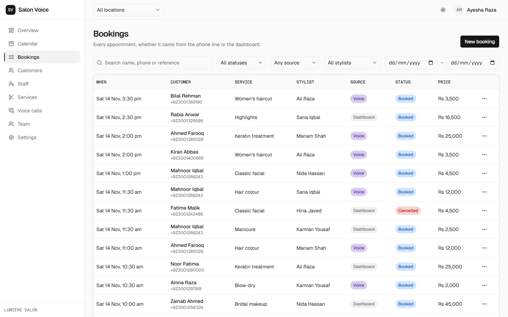
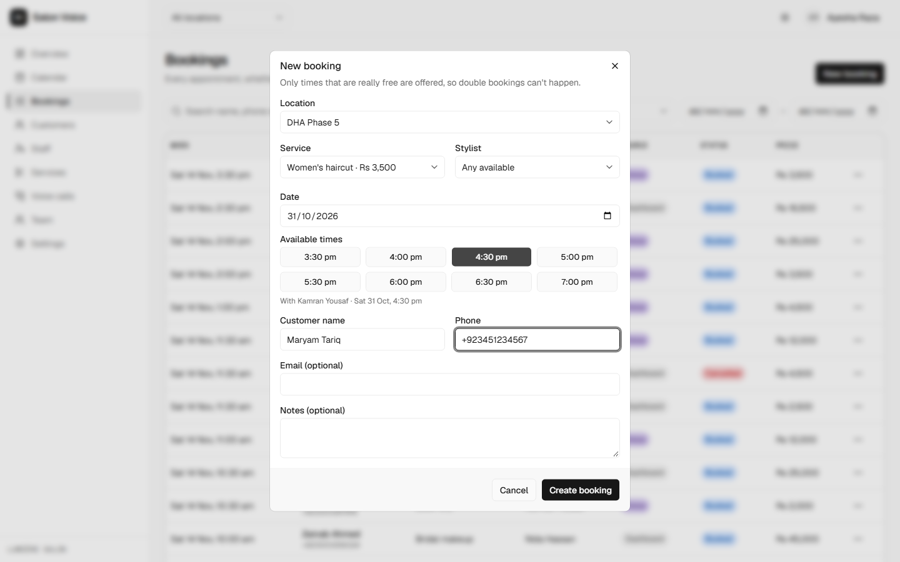
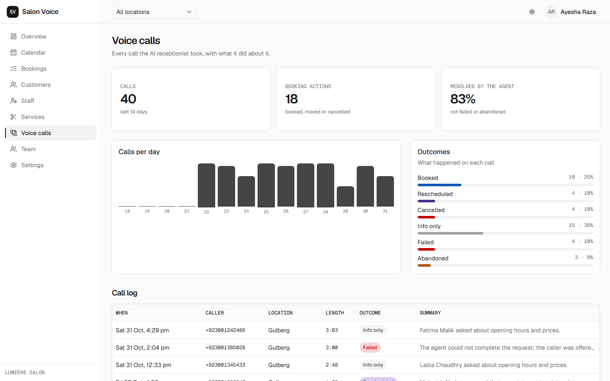
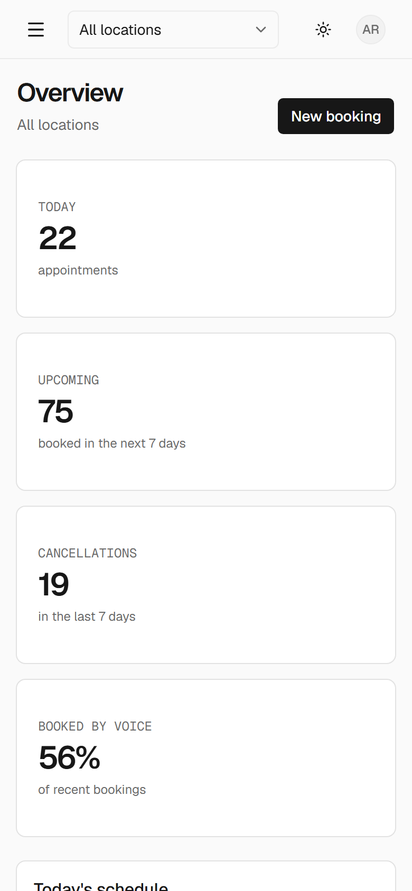

# Salon Voice Booking

An AI-powered, multi-location salon booking platform. Customers call a natural-sounding **Retell AI** receptionist that answers questions, checks real-time availability, and books, reschedules, or cancels appointments. Salon owners, managers, and staff run everything from a responsive admin dashboard.

> **Status:** M0 (foundation), M1 (tenancy + auth) and the dashboard (M8a, on sample data) are built. Next: services/schedules, availability and booking in the backend, then the voice agent.

## Quick start
```bash
docker compose up -d db                       # Postgres 18 on localhost:5544

cd backend
cp .env.example .env
uv sync
uv run alembic upgrade head
uv run python -m app.scripts.seed             # demo logins, e.g. owner@demo.example.com
uv run uvicorn app.main:app --reload          # http://localhost:8000/docs

cd ../frontend
cp .env.example .env.local
pnpm install
pnpm dev                                      # http://localhost:3000
```

The dashboard starts in **demo mode** (`NEXT_PUBLIC_API_MOCKS=true` in `frontend/.env.local`): it runs on built-in sample data, so every page works without the backend. Sign in with the demo buttons on the login page. Set it to `false` to use the real backend (sign-in, business, locations and team are real today; the rest arrives with later backend modules).

Run everything in containers instead: `docker compose up --build`.

### Checks
| | Command |
|---|---|
| Backend | `uv run ruff format --check . && uv run ruff check . && uv run mypy && uv run pytest` |
| Frontend | `pnpm lint && pnpm typecheck && pnpm test && pnpm build && pnpm e2e` |

CI runs all of these on every push and pull request.

## Dashboard
| | |
|---|---|
|  |  |
|  |  |
|  |  |

## Highlights
- **Voice receptionist** — Retell AI custom functions backed by real booking APIs; never confirms an action the backend didn't confirm.
- **Conflict-proof booking** — PostgreSQL exclusion constraints and idempotency keys prevent double bookings, even under simultaneous requests.
- **Multi-tenant** — one business can run many salons, each with its own hours, timezone, staff, prices, and phone number.
- **Admin dashboard** — calendars (day/week/month), bookings, staff schedules, services, customers, call logs and analytics.
- **Notifications** — booking confirmations and reminders by email via Amazon SES.

## Stack
| Layer | Technology | Hosting |
|---|---|---|
| Voice agent | Retell AI | Retell |
| Backend | Python, FastAPI, SQLAlchemy, Alembic | AWS ECS Fargate (Docker) |
| Database | PostgreSQL | AWS RDS |
| Frontend | Next.js, Tailwind CSS, shadcn/ui, FullCalendar | Vercel |
| Email | Amazon SES | AWS |

## Documentation
- [Requirements brief](docs/requirements.md)
- [Architecture and build plan](docs/architecture.md)
- [API contract](docs/api-contract.md)
- [Module briefs](docs/modules/)
- [Design system](docs/design-file.txt) and [theme tokens](docs/design-tokens.css)
- [CLAUDE.md](CLAUDE.md) — project memory for AI coding agents

## Roadmap
M0 Foundation → M1 Tenancy + Auth → M2 Catalog + Schedules → M3 Availability engine → M4 Booking engine → M5 Deploy skeleton → M6 Voice agent → M7 Notifications → M8 Dashboard → M9 Docs + demo.
